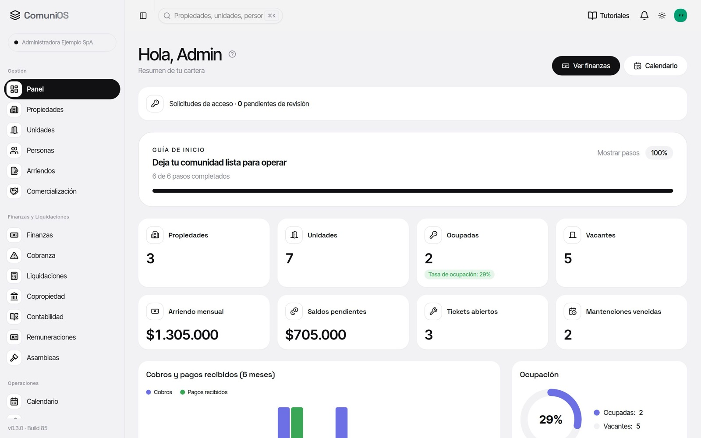
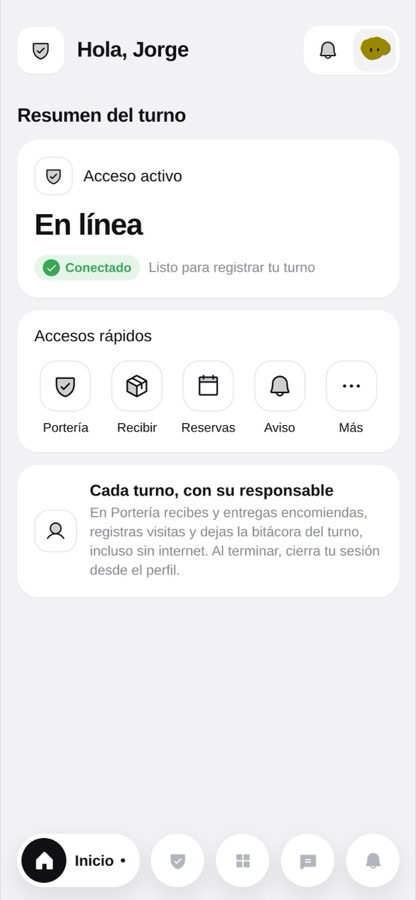
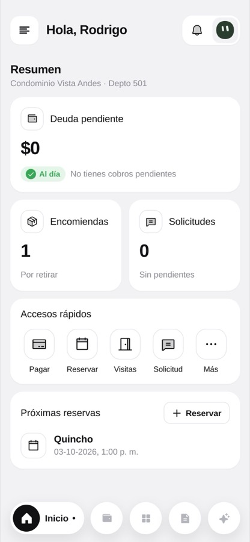

<picture>
  <source media="(prefers-color-scheme: dark)" srcset="https://capsule-render.vercel.app/api?type=transparent&height=140&text=Alex%20Elgueta&fontSize=68&fontColor=78a7ff&fontAlignY=42&desc=AI%20Software%20Engineer%20%C2%B7%20Indie%20Builder&descSize=18&descColor=aaaaaa&descAlignY=78" />
  <source media="(prefers-color-scheme: light)" srcset="https://capsule-render.vercel.app/api?type=transparent&height=140&text=Alex%20Elgueta&fontSize=68&fontColor=1748c7&fontAlignY=42&desc=AI%20Software%20Engineer%20%C2%B7%20Indie%20Builder&descSize=18&descColor=666666&descAlignY=78" />
  
</picture>

> **Ship something people actually use.**

  <a href="https://comunios.cl">
    <picture>
      <source media="(prefers-color-scheme: dark)" srcset="https://img.shields.io/badge/Building-ComuniOS-78a7ff?style=flat-square&logoColor=071a3d&labelColor=78a7ff" />
      <source media="(prefers-color-scheme: light)" srcset="https://img.shields.io/badge/Building-ComuniOS-1748c7?style=flat-square&logoColor=fffdf7&labelColor=1748c7" />
      
    </picture>
  </a>
  <a href="https://alexelgueta.me">
    <picture>
      <source media="(prefers-color-scheme: dark)" srcset="https://img.shields.io/badge/Website-alexelgueta.me-78a7ff?style=flat-square&logo=safari&logoColor=071a3d&labelColor=78a7ff" />
      <source media="(prefers-color-scheme: light)" srcset="https://img.shields.io/badge/Website-alexelgueta.me-1748c7?style=flat-square&logo=safari&logoColor=fffdf7&labelColor=1748c7" />
      
    </picture>
  </a>
  <a href="https://github.com/kanazawa-dev">
    <picture>
      <source media="(prefers-color-scheme: dark)" srcset="https://img.shields.io/badge/GitHub-kanazawa--dev-78a7ff?style=flat-square&logo=github&logoColor=071a3d&labelColor=78a7ff" />
      <source media="(prefers-color-scheme: light)" srcset="https://img.shields.io/badge/GitHub-kanazawa--dev-1748c7?style=flat-square&logo=github&logoColor=fffdf7&labelColor=1748c7" />
      
    </picture>
  </a>
  <a href="https://twitter.com/AlexElguetaDev">
    <picture>
      <source media="(prefers-color-scheme: dark)" srcset="https://img.shields.io/badge/X-@AlexElguetaDev-78a7ff?style=flat-square&logo=x&logoColor=071a3d&labelColor=78a7ff" />
      <source media="(prefers-color-scheme: light)" srcset="https://img.shields.io/badge/X-@AlexElguetaDev-1748c7?style=flat-square&logo=x&logoColor=fffdf7&labelColor=1748c7" />
      
    </picture>
  </a>

  <a href="./README.md">English</a> · <a href="./README.es.md">Español</a>

---

## Hi, I'm Alex

I'm a software engineer and product builder based in **Los Ángeles, Chile**. I build products end to end: architecture, backend, interfaces, and the infrastructure that gets them into people's hands.

My main focus is **[ComuniOS](https://comunios.cl)**, where I'm **Founder, CEO & CTO**. I lead the product and engineering, building software that makes running a residential community simpler and more transparent.

## Main focus · [ComuniOS](https://comunios.cl)

### Less chaos. More community.

<table>
  <tr>
    <th>Administration</th>
    <th>Concierge web</th>
    <th>Residents web</th>
  </tr>
  <tr>
    <td width="64%" align="center" valign="top"></td>
    <td width="18%" align="center" valign="top"></td>
    <td width="18%" align="center" valign="top"></td>
  </tr>
</table>

Product screenshots from the ComuniOS website.

**One platform for condominium and residential building management in Chile.** ComuniOS brings together the work that usually lives across spreadsheets, folders, and WhatsApp groups, with dedicated web spaces for administration, concierge staff, and residents.

- **Clearer finances:** common expense billing, online payments, bank reconciliation, accounting, and reporting to the management committee.
- **Everyday operations:** visitor and parcel logs, shared-space reservations, requests, and community announcements.
- **A connected community:** administrators manage the building, concierge staff handle daily operations, and residents check their balance, pay, and stay informed.
- **AI with context:** an assistant that answers questions using community data, with each person accessing only the information relevant to their role.

Built for Chilean communities, with workflows designed around **Law 21.442 on condominium co-ownership**. Available on the web from a phone or computer; native iOS and Android apps are coming next.

It started with the lack of transparency in my own building. I'm building it with my neighbor, Francisco Urzúa: we share the same community and the problems we're solving.

**My role:** product vision, software architecture, and end-to-end development across the administration, resident, and concierge experiences.

**[Explore ComuniOS →](https://comunios.cl)** · [Meet the team](https://comunios.cl/equipo) · [Why I built it](https://comunios.cl/blog/por-que-cree-comunios)

---

## Other products

| Project | What it does | Links |
| --- | --- | --- |
| **Voysse** | Open-source, white-label AI agents for agencies, with WhatsApp and web chat, branded client portals, and self-hosting. | [Website](https://voysse.cl) · [Docs](https://docs.voysse.cl) · [Code](https://github.com/kanazawa-dev/voysse) |
| **Titvo** | AI-powered code security review. I help build it at Karibu. | [Website](https://titvo.com) · [Code](https://github.com/KaribuLab/titvo-security-scan) |
| **Mushu** | AI-assisted food tracking with less friction. | — |
| **Violet** | Simpler personal finance. | — |

## Engineering & experience

**Languages:** TypeScript, Python, Rust 
**Building with:** React, Next.js, NestJS, FastAPI, PostgreSQL, Docker 
**Shipping on:** Railway, Vercel, AWS, Cloudflare

- **ComuniOS · Founder, CEO & CTO:** product and technology for residential communities.
- **Karibu · Fullstack Engineer:** scalable web applications and AI-powered products.
- **Previously, Portal de Especialistas · CTO:** engineering, architecture, and product for a marketplace connecting homeowners with specialists.

I value simple systems, clean architecture, and shipping useful software.

---

### Let's connect

[ComuniOS](https://comunios.cl) · [Personal website](https://alexelgueta.me) · [X / Twitter](https://twitter.com/AlexElguetaDev)

Building ComuniOS · Los Ángeles, Chile

---

Easter egg, the contribution snake

 

<picture>
  <source media="(prefers-color-scheme: dark)" srcset="https://raw.githubusercontent.com/kanazawa-dev/kanazawa-dev/output/github-contribution-grid-snake-dark.svg" />
  <source media="(prefers-color-scheme: light)" srcset="https://raw.githubusercontent.com/kanazawa-dev/kanazawa-dev/output/github-contribution-grid-snake.svg" />
  
</picture>

